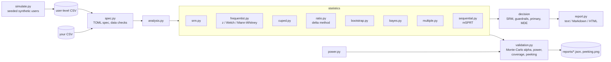
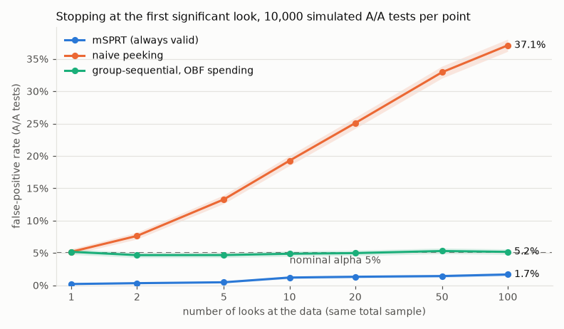

# ab-test-analyzer

[](https://github.com/rahulkumar96t/ab-test-analyzer/actions/workflows/ci.yml)

A statistics toolkit and CLI for analysing online controlled experiments (A/B tests). Given a
user-level CSV and a small TOML spec it checks the sample ratio, tests the primary and secondary
metrics (z-test, Welch, Mann-Whitney, bootstrap, delta method for ratio metrics, CUPED variance
reduction, Holm / Benjamini-Hochberg correction), adds a Bayesian reading (probability to beat
control, expected loss), runs guardrail non-inferiority checks and an always-valid sequential
p-value, and prints a ship / don't ship / inconclusive / invalid decision. A Monte-Carlo suite
measures whether each procedure actually holds its nominal false-positive rate and reaches its
planned power, and a peeking simulation shows what repeated looks do to a fixed-horizon test.

## Problem

Most bad experiment decisions are not caused by the wrong formula but by the wrong procedure:
trusting results from a broken split, testing a per-session metric as if sessions were
independent, checking a dashboard every day and stopping at the first p < 0.05, or reading
"not significant" as "no effect". This project implements the standard remedies and, more
importantly, measures that they work: every claim in the results section below comes from a
simulation that can be re-run with one command.

## Features

| Area | What is implemented | Module |
|---|---|---|
| Checks | sample-ratio mismatch (chi-square goodness of fit, strict 0.001 threshold); guardrails as one-sided non-inferiority tests against a relative margin (pass / fail / inconclusive) | `srm.py`, `analysis.py` |
| Frequentist | pooled two-proportion z-test; Welch t-test from raw data or summary statistics; Mann-Whitney U with tie and continuity correction; relative lift with delta-method CI | `frequentist.py` |
| Resampling | two-sample bootstrap (percentile / basic) for any statistic, units resampled with all their columns | `bootstrap.py` |
| Ratio metrics | delta method for ratio-of-sums metrics such as revenue per session | `ratio.py` |
| Multiple testing | Bonferroni, Holm, Benjamini-Hochberg adjusted p-values | `multiple.py` |
| Variance reduction | CUPED with a pre-experiment covariate (pooled theta), reports the variance reduction it achieved | `cuped.py` |
| Bayesian | beta-binomial for conversion (P(better) by quadrature, expected loss in closed form + quadrature); normal model with flat or normal prior for continuous metrics | `bayes.py` |
| Sequential | mSPRT with always-valid p-values and confidence sequences; group-sequential boundaries for Lan-DeMets O'Brien-Fleming / Pocock spending by recursive numerical integration | `sequential.py` |
| Power | sample size, power and MDE for proportions and means; allocation ratio, CUPED variance reduction, separate treatment SD, noncentral-t refinement | `power.py` |
| Data | seeded simulator with planted effects (conversion, order value, sessions, guardrail regressions, SRM); CSV input validated against the spec | `simulate.py`, `spec.py` |
| Validation | Monte-Carlo false-positive rate, power and coverage with Wilson intervals; peeking simulation | `validation.py` |
| Output | `abtest` CLI; text report on stdout, optional Markdown or self-contained HTML | `cli.py`, `report.py` |

## Architecture



The analysis order is fixed and deliberate: the SRM check runs first and overrides everything,
the primary metric is tested at the full alpha, secondary metrics are corrected as one family,
guardrails are non-inferiority checks, and "no significant change" is always reported together
with the minimum detectable effect of the sample at hand.

## Data

There is no public dataset of user-level A/B test results with known ground truth, so the data
is **synthetic**: `abtest simulate` (`simulate.py`) generates one row per user from a fixed seed.
Each user has two latent traits (engagement and spend level, log-normal with mean 1) that drive
sessions, conversion, order value and the pre-experiment covariates `pre_sessions` and
`pre_revenue` (an 8-week pre-period). Planted, configurable effects on the treatment arm:
relative lifts in conversion, order value and sessions, slower page loads and more bounces
(guardrail regressions), and a skewed actual allocation (sample-ratio mismatch). Columns:
`user_id, variant, day, pre_revenue, pre_sessions, sessions, converted, revenue, page_load_ms,
bounced`. Nothing in it describes real users, and the numbers say nothing about real products.

Your own data works the same way: one row per randomisation unit, a variant column and numeric
metric columns, described by a spec like [`examples/checkout.toml`](examples/checkout.toml).
The only committed data file is a 60-row synthetic fixture for tests (2 KB). Generated data goes
to the git-ignored `data/` folder. Licence: everything here, including the fixture, is MIT.

## Quickstart

Requires [uv](https://docs.astral.sh/uv/); Python 3.12 is pinned in `.python-version`
(`requires-python >= 3.11`, tested on 3.12).

```bash
make install    # uv sync --locked
make test       # pytest, 90 tests, about 7 s
make demo       # simulate 120k users and print the decision report
make validate   # Monte-Carlo checks -> reports/validation.json
make peeking    # peeking simulation -> reports/peeking.json + reports/peeking.png
```

## Usage

```bash
# synthetic experiment: +8 % conversion, +3 % sessions, page load 0.5 % slower
uv run abtest simulate --users 120000 --seed 7 --conversion-lift 0.08 \
    --sessions-lift 0.03 --page-load-lift 0.005 --out data/experiment.csv

# decision report (stdout) plus a Markdown or HTML file
uv run abtest analyze data/experiment.csv --spec examples/checkout.toml --report out/report.html

# power: users per arm for +5 % relative on a 10 % baseline, and the MDE of a given sample
uv run abtest power binary --baseline 0.10 --mde 0.05 --relative   # control 57,763, treatment 57,763
uv run abtest power continuous --sd 1 --mde 0.5 --t                 # control 64, treatment 64
uv run abtest power binary --baseline 0.10 --n 20000 --relative     # MDE (relative) ... 8.5621%

# sample-ratio check on raw counts (exit code 1 on a mismatch)
uv run abtest srm 50812 49188   # chi-square 26.374, p 2.81e-07 -> MISMATCH
```

The spec decides what is analysed and how (excerpt):

```toml
control = "control"
treatment = "treatment"
correction = "holm"        # none | bonferroni | holm | bh (secondary metrics)
look_column = "day"        # cumulative looks for the always-valid p-value

[primary]
name = "conversion"
kind = "binary"            # binary | continuous | ratio
column = "converted"

[[secondary]]
name = "revenue_per_user"
kind = "continuous"
column = "revenue"
covariate = "pre_revenue"  # CUPED
robust = true              # also Mann-Whitney
bootstrap = true

[[guardrails]]
name = "page_load_ms"
kind = "continuous"
column = "page_load_ms"
direction = "decrease"     # lower is better
margin = 0.02              # at most 2 % worse
```

Output of `make demo` (abbreviated; full report in
[`reports/example_report.md`](reports/example_report.md)). The planted conversion lift was
+8 %; the measured one is +7.05 %:

```text
Verdict: SHIP
- conversion improved: +7.05% (p = 0.00039)

metric      control  treatment  difference [CI]                relative [CI]             p       P(better)
conversion  8.00%    8.57%      +0.56 pp [+0.25 pp, +0.88 pp]  +7.05% [+3.02%, +11.08%]  0.0004  100.0%

metric                     relative [CI]             p        adj. p   result
revenue_per_user (CUPED)   +6.33% [+0.20%, +12.45%]  0.0365   0.0730   no detectable change
revenue_per_session        +4.07% [-1.88%, +10.01%]  0.1705   0.1705   no detectable change
sessions_per_user (CUPED)  +1.82% [+1.27%, +2.38%]   <0.0001  <0.0001  better

page_load_ms (lower is better)  degradation +0.23%  worst case +0.58%  margin 2.0%  PASS
bounce_rate (lower is better)   degradation +0.08%  worst case +1.53%  margin 3.0%  PASS

14 cumulative looks on 'day'; always-valid p 0.0029; first below 0.05 at look 6
- sessions_per_user: CUPED on pre_sessions (correlation 0.889) reduced the variance of the
  estimate by 79.0%; CI width 0.09624 -> 0.04406
- revenue_per_user: CUPED on pre_revenue (correlation 0.162) reduced the variance by 2.6%
```

Revenue per user carried the same +8 % planted lift (it comes from conversion), but after the
Holm correction it is not significant at this sample size, which is the honest answer.

## Results (measured)

All numbers below come from the committed runs in [`reports/`](reports/) on an Apple M4 Pro
(12 cores, 24 GB), Python 3.12.11, NumPy 2.5.5, SciPy 1.18.1, single process, CPU only. Each
rate has a 95 % Wilson interval for the Monte-Carlo error. The data is synthetic throughout.

### Do the tests hold alpha and reach the planned power?

`uv run abtest validate --sims 2000 --seed 2026 --out reports/validation.json`
(19 checks; 135.5 s of computation by the command's own timer in the committed run, while the
machine was shared with other jobs at a load average of about 10; an earlier run of the same
command and seed, with identical results, took 49.6 s). Count-based checks use 20,000 simulated experiments, the
bootstrap 500 (each with 1,000 resamples), the rest 2,000.

| procedure | scenario | quantity | target | measured [95 % MC interval] |
|---|---|---|---:|---:|
| two-proportion z-test | conversion 10 %, 57,763 / arm, A/A | false-positive rate | 5.0 % | 4.66 % [4.37, 4.96] |
| two-proportion z-test | same, +5 % relative lift | power | 80.0 % | 80.08 % [79.52, 80.62] |
| SRM chi-square, threshold 0.001 | 100,000 users, 50/50 | false-positive rate | 0.10 % | 0.10 % [0.07, 0.16] |
| SRM chi-square, threshold 0.001 | 100,000 users, actual split 50.5/49.5 | detection rate | - | 44.74 % [44.05, 45.43] |
| beta-binomial, ship if P(better) > 95 % | conversion 10 %, 5,000 / arm, A/A | false-positive rate | 5.0 % | 4.45 % [3.63, 5.44] |
| Welch t-test | zero-inflated revenue, 18,268 / arm, A/A | false-positive rate | 5.0 % | 5.45 % [4.54, 6.53] |
| Mann-Whitney U | same, A/A | false-positive rate | 5.0 % | 5.50 % [4.58, 6.59] |
| Welch t-test | same, +15 % via order value | power | 73.9 % * | 73.55 % [71.57, 75.44] |
| Mann-Whitney U | same, +15 % via order value | power | - | 5.65 % [4.72, 6.75] |
| Welch t-test | same, +15 % via conversion | power | 77.2 % * | 76.85 % [74.95, 78.65] |
| Mann-Whitney U | same, +15 % via conversion | power | - | 99.50 % [99.08, 99.73] |
| delta method (user level) | clicks / page views, 5,000 users / arm, A/A | false-positive rate | 5.0 % | 4.15 % [3.36, 5.12] |
| naive page-view-level z-test | same | false-positive rate | 5.0 % | **22.45 %** [20.68, 24.33] |
| Welch t-test, raw | simulator sessions / user, 20,000 users, A/A | false-positive rate | 5.0 % | 5.80 % [4.86, 6.91] |
| Welch t-test, CUPED | same, A/A | false-positive rate | 5.0 % | 4.70 % [3.86, 5.72] |
| Welch t-test, raw | same, +2 % sessions | power | - | 16.60 % [15.03, 18.29] |
| Welch t-test, CUPED | same, +2 % sessions | power | - | **58.55 %** [56.38, 60.69] |
| bootstrap percentile CI | zero-inflated revenue, 1,000 / arm | coverage | 95.0 % | 94.00 % [91.56, 95.77] |
| Welch t CI | same | coverage | 95.0 % | 95.80 % [93.66, 97.24] |

\* The revenue sample size was planned for 80 % power using the control standard deviation.
A lift in revenue also widens the treatment arm's spread, so the real power is lower; the
target column is what `power_means(..., sd_treatment=...)` predicts with the true treatment SD,
and the simulation reproduces it. Planning with the control SD alone would have promised 80 %.

What the table shows:

- **Nominal alpha holds** for every test that should hold it, within Monte-Carlo error, with
  one 2.3-standard-error miss: the z-test A/A rate of 4.66 % on 20,000 runs. With about a dozen
  targeted rows one such miss is expected by chance; three extra runs of 400,000 A/A z-tests
  each (seeds 1-3, not part of the committed report) measured 4.99 %, 5.04 % and 5.00 %.
- **Session-level analysis of a user-randomised ratio metric is wrong**: treating 5,000 users'
  page views as independent gave a 22 % false-positive rate; the delta method at user level 4.2 %.
- **Mann-Whitney tests a different hypothesis.** On revenue where 90 % of users spend nothing,
  a 15 % higher order value is almost invisible to it (5.7 % power) while a 15 % higher
  conversion rate is detected 99.5 % of the time. It is reported next to the mean test as a
  robustness signal, never in place of it.
- **CUPED is unbiased and as strong as the covariate.** Over 2,000 simulated experiments with a
  true effect of +0.0600 sessions, the mean estimate was 0.0591 raw and 0.0596 with CUPED; the
  standard deviation of the estimate fell from 0.0624 to 0.0273, an empirical variance
  reduction of 80.8 % against a mean rho^2 of 79.9 %, which tripled the power at the same sample
  size. The same covariate trick on purchase revenue (`pre_revenue`, correlation about 0.16)
  removed only 2.7 % of the variance: sparse one-off purchases are hard to predict.
- **The Bayesian "P(better) > 95 %" rule** is, with a flat prior and a single look, a one-sided
  5 % test, and behaves like one (4.45 %).

### What peeking does

`uv run abtest peeking --sims 10000 --seed 2026 --out reports/peeking.json --plot reports/peeking.png`
(14 scenarios x 10,000 simulated experiments; 18.5 s in the committed run at a load average of
about 20, 10.5 s in an earlier identical run). Conversion at 10 %, 20,000 users per arm in
total, analysed after every 1/K of the sample; each method stops at its first rejection. mSPRT
uses a normal mixture with tau = 10 % of the baseline (the planned effect size).



| looks | naive peeking | fixed horizon (last look only) | mSPRT | group-sequential (OBF spending) |
|---:|---:|---:|---:|---:|
| 1 | 5.18 % | 5.18 % | 0.20 % | 5.18 % |
| 2 | 7.64 % | 4.60 % | 0.33 % | 4.67 % |
| 5 | 13.28 % | 4.30 % | 0.47 % | 4.68 % |
| 10 | 19.27 % | 4.89 % | 1.20 % | 4.88 % |
| 20 | 25.08 % | 4.98 % | 1.32 % | 4.98 % |
| 50 | 32.94 % | 5.20 % | 1.43 % | 5.30 % |
| 100 | 37.09 % | 5.15 % | 1.67 % | 5.17 % |

False-positive rates of A/A tests (Monte-Carlo half-width about 0.4-1 percentage point; full
intervals in `reports/peeking.json`). Checking a fixed-horizon test 20 times and stopping at the
first p < 0.05 produced a false positive in one experiment out of four.

With a real +10 % relative lift (same design, 20 looks):

| method | power | average share of the planned sample used |
|---|---:|---:|
| fixed horizon | 90.6 % | 100 % |
| group-sequential, OBF spending | 88.9 % | 66 % |
| mSPRT | 66.9 % | 72 % |
| naive peeking | 94.6 % | (invalid: 25 % false positives) |

The trade-off is visible: the group-sequential design keeps alpha at 5 % and nearly all the
power while stopping a third earlier on average, but needs the number and timing of looks fixed
in advance. mSPRT allows looking at any time, indefinitely, and pays for it with a conservative
false-positive rate (well under 5 %) and less power at a fixed maximum sample.

## How to reproduce

```bash
make install
make reports   # demo + validate + peeking: writes reports/example_report.md,
               # reports/validation.json, reports/peeking.json, reports/peeking.png
```

All randomness is seeded (`--seed`); the same seeds give identical numbers on the same library
versions (`uv.lock`).

## Design decisions and trade-offs

- **SRM first, and it overrides everything.** A mismatch means users were lost or added
  unequally, so every metric is suspect; the verdict is `invalid` even if the primary metric
  looks great. The threshold is 0.001 because the check runs on every experiment.
- **Primary at full alpha, secondaries corrected.** The primary metric is the pre-registered
  decision metric; correcting it for every secondary added later would punish adding metrics.
  Secondary metrics are adjusted as one family (Holm by default, BH optional).
- **Guardrails are non-inferiority tests, not "is it significant".** A guardrail passes only if
  the one-sided upper bound of the degradation is below its margin; it fails when a degradation
  is significant and may exceed the margin; otherwise it is inconclusive, and an inconclusive
  guardrail turns a winning primary metric into an `inconclusive` verdict instead of `ship`.
- **Report the MDE with every null result.** "No detectable change" is printed with the
  relative effect this sample could have detected at the configured power, approximated as
  (z_alpha/2 + z_power) x SE of the observed difference. No post-hoc power.
- **CUPED theta from the pooled sample**, centred on the pooled covariate mean. The covariate is
  fixed before assignment, so this keeps the estimator consistent; per-arm theta would let the
  treatment effect into the adjustment. CUPED is offered for continuous metrics only.
- **Ratio metrics at the randomisation unit.** The delta method uses per-user numerator and
  denominator totals; the bootstrap resamples users with both columns together.
- **Array-level cores, scalar wrappers.** Each test has a vectorised core used by the Monte-Carlo
  code (thousands of experiments per call) and a wrapper returning a typed result. The same code
  path is validated and used in reports.
- **Reference checks against independent implementations.** z-test squared equals SciPy's
  Pearson chi-square; Welch, Mann-Whitney (with ties), BH and the bootstrap are compared to SciPy;
  power to Cohen's tables; the group-sequential code reproduces gsDesign's published O'Brien-
  Fleming bounds (4.877, 3.357, 2.680, 2.290, 2.031); P(better) to Evan Miller's closed form.
- **Two sequential methods, on purpose.** mSPRT for "look whenever you like"; group-sequential
  spending for planned interim analyses with better power. The report computes the mSPRT
  always-valid p-value over the `look_column` (for example the day of exposure) as a guard
  against the dashboard having been watched daily.
- **Plain dependencies.** NumPy, SciPy, pandas and matplotlib; argparse for the CLI; no
  experiment platform SDK. The HTML report is one self-contained file.

## Testing

```bash
uv run ruff check . && uv run ruff format --check . && uv run pytest -q
```

90 tests, 7-8 s on the machine above (21 s while it was heavily loaded by other jobs), offline,
no network or external services:

- **Reference values**: z-test vs `scipy.stats.chi2_contingency`; Welch statistic, df, p and CI
  vs `scipy.stats.ttest_ind`; Mann-Whitney with heavy ties vs `scipy.stats.mannwhitneyu`
  (scalar and vectorised); BH vs `scipy.stats.false_discovery_control`; the Benjamini-Hochberg
  (1995) example (BH rejects 4, Bonferroni and Holm 3); SRM vs `scipy.stats.chisquare`; Cohen's
  64 / 26 per group; gsDesign boundaries; Evan Miller's P(B > A) formula; bootstrap vs
  `scipy.stats.bootstrap`.
- **Statistical properties with fixed seeds and tolerances**: z-test false-positive rate on
  40,000 A/A runs within 0.5 pp of 5 %; Welch and Mann-Whitney on skewed data; CUPED unbiased in
  Monte-Carlo (mean within 4 MC standard errors) and variance reduction close to rho^2; boundary
  crossing probability equals alpha on 400,000 simulated paths; mSPRT stays below alpha under
  200 looks while naive peeking exceeds 25 %; planned power reached in simulation; delta-method
  SE matches the bootstrap SE.
- **Simulator**: same seed gives the same frame, planted effects are recovered, SRM planting.
- **Spec and data validation**: every malformed spec and data case raises a clear error.
- **End to end**: decision logic (ship, invalid on SRM, do-not-ship on a guardrail regression,
  inconclusive with MDE), all three renderers, every CLI command including the committed fixture
  with custom arm names.

## Limitations and roadmap

- Two arms only (one control, one treatment). A/B/n with Dunnett-style comparisons is the next
  natural step.
- Normal approximations everywhere except the Welch t distribution: fine for the sample sizes of
  online experiments, not for tiny samples (no exact tests).
- The bootstrap offers percentile and basic intervals, not BCa; on small skewed samples the
  percentile interval under-covers slightly (94.0 % measured above).
- The normal Bayesian model uses the plug-in standard error; there is no hierarchical model or
  prior learned from past experiments.
- Guardrail margins are relative only, and outlier capping / winsorisation of revenue is not
  implemented (it would make both the t-test and CUPED more powerful).
- mSPRT uses a plug-in variance; its validity was checked by simulation for these scenarios,
  not proven for every metric. The group-sequential code computes efficacy boundaries only
  (no futility bounds).
- No network effects, novelty effects or interference between users are modelled.

## Project layout

```
src/abtest/
  simulate.py     seeded synthetic experiments with planted effects
  spec.py         TOML spec, CSV loading and validation
  srm.py          sample-ratio mismatch
  frequentist.py  z-test, Welch, Mann-Whitney (vectorised cores + typed results)
  bootstrap.py    two-sample bootstrap CIs
  ratio.py        delta method for ratio metrics
  cuped.py        CUPED variance reduction
  multiple.py     Bonferroni, Holm, Benjamini-Hochberg
  bayes.py        beta-binomial and normal models
  sequential.py   mSPRT, alpha spending, group-sequential boundaries
  power.py        sample size, power, MDE
  analysis.py     metric analysis, guardrails, decision
  report.py       text, Markdown and HTML reports
  validation.py   Monte-Carlo checks and the peeking simulation
  plots.py        peeking chart
  cli.py          abtest command
examples/         experiment spec for simulated data
reports/          committed outputs of `make reports`
tests/            pytest suite and a 60-row fixture
```

## References

- Deng, Xu, Kohavi, Walker (2013). Improving the sensitivity of online controlled experiments by
  utilizing pre-experiment data (CUPED).
- Deng, Knoblich, Lu (2018). Applying the delta method in metric analytics.
- Johari, Koomen, Pekelis, Walsh (2017). Peeking at A/B tests: why it matters, and what to do
  about it (mSPRT).
- Lan, DeMets (1983). Discrete sequential boundaries for clinical trials.
- Benjamini, Hochberg (1995). Controlling the false discovery rate.
- Fabijan et al. (2019). Diagnosing sample ratio mismatch in online controlled experiments.
- Kohavi, Tang, Xu (2020). Trustworthy Online Controlled Experiments.

## License

MIT, see [LICENSE](LICENSE).
